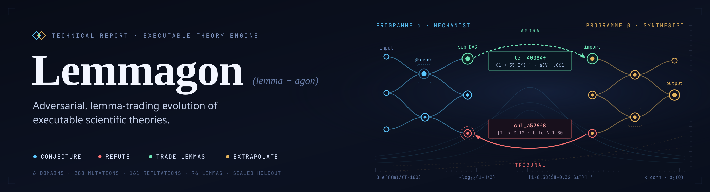
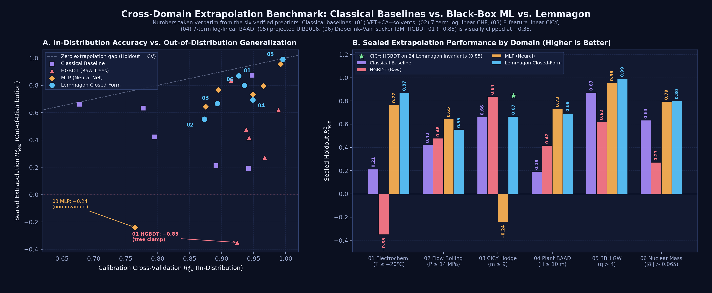
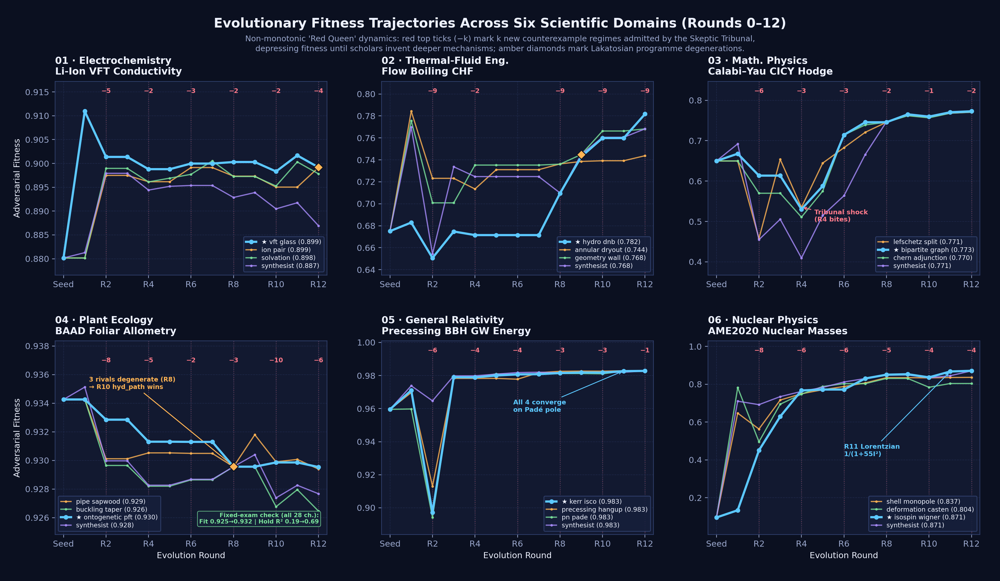
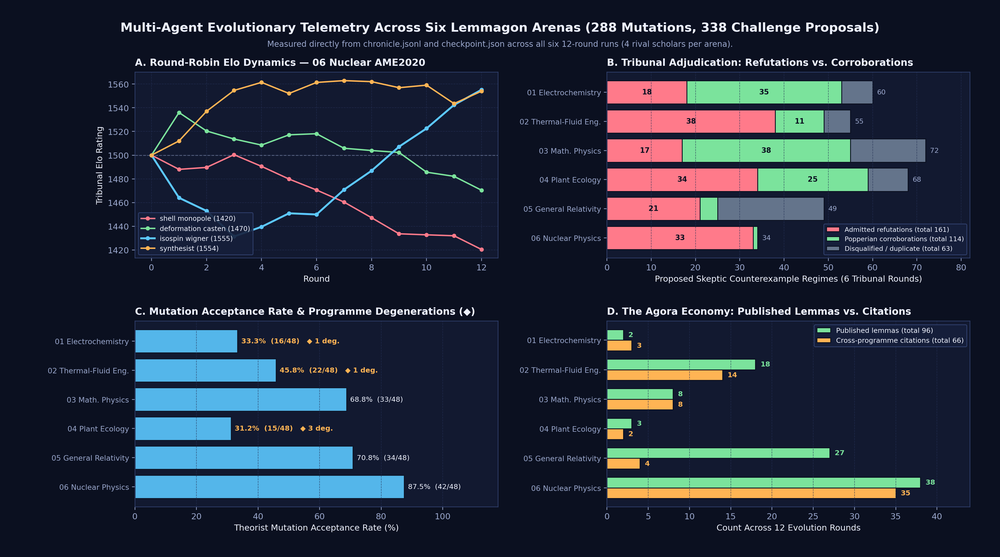
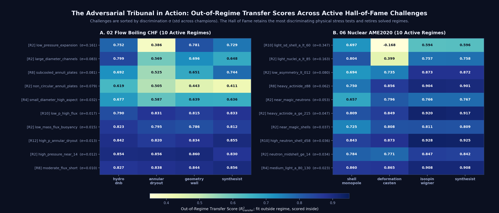
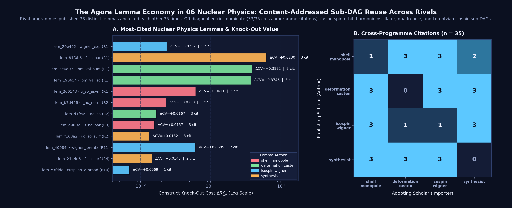
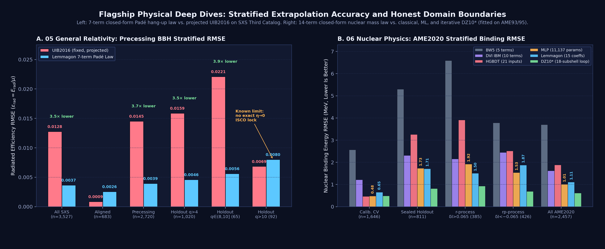

<p align="center">
  
</p>

# Lemmagon: Adversarial, Lemma-Trading Evolution of Executable Scientific Theories

**Technical Report & Cross-Domain Empirical Evaluation**  
*Repository:* [`github.com/suayptalha/lemmagon`](https://github.com/suayptalha/lemmagon) · *License:* Apache-2.0

---

> **TL;DR.** **Lemmagon** (*lemma* + *agon*, Greek for contest) is an open-source, multi-agent evolutionary engine for discovering executable, closed-form scientific theories. Instead of evolving isolated black-box programs or flat expression trees against a single in-distribution metric, rival LLM-driven research programmes (*scholars*) evolve modular **theory graphs** (DAGs of competing Python-lambda hypotheses), attack each other with **executable counterexample regimes** adjudicated by a **Tribunal**, and trade **content-addressed, knock-out-verified sub-theories** (*lemmas*) through a shared **Agora**—while a **sealed holdout** tests true out-of-distribution extrapolation. Across six real-world scientific benchmarks spanning electrochemistry, thermal-fluid engineering, Calabi–Yau algebraic geometry, plant ecology, numerical relativity, and nuclear physics (**288 theorist mutations**, **338 counterexample proposals**, **161 admitted refutations**, **96 published lemmas**, and **66 cross-programme citations**), Lemmagon discovers compact 6-to-24-term analytical laws that consistently beat classical closed-form baselines and decision-tree ensembles on out-of-distribution extrapolation, while exposing transparent domain boundaries and honest accuracy trade-offs against neural networks and iterative microscopic solvers.

---

## Table of Contents

1. [Motivation: Why Automated Discovery Needs Adversaries and Lemmas](#1-motivation-why-automated-discovery-needs-adversaries-and-lemmas)
2. [Architecture and Methodology](#2-architecture-and-methodology)
   - [2.1 Executable Theory Graphs](#21-executable-theory-graphs)
   - [2.2 The Magistrate and Appraisal Engine](#22-the-magistrate-and-appraisal-engine)
   - [2.3 The Tribunal: Executable Refutations, Hall of Fame, and Elo](#23-the-tribunal-executable-refutations-hall-of-fame-and-elo)
   - [2.4 The Agora: Content-Addressed Lemma Exchange and Lakatosian Degeneration](#24-the-agora-content-addressed-lemma-exchange-and-lakatosian-degeneration)
   - [2.5 Novelty Gate, Sandbox, and Decoupled Oracle Protocol](#25-novelty-gate-sandbox-and-decoupled-oracle-protocol)
3. [Positioning Against Related Work](#3-positioning-against-related-work)
4. [Cross-Domain Empirical Benchmark](#4-cross-domain-empirical-benchmark)
5. [Inside the Arena: Multi-Agent Evolutionary Telemetry](#5-inside-the-arena-multi-agent-evolutionary-telemetry)
6. [Six Scientific Case Studies (Discoveries and Scope Boundaries)](#6-six-scientific-case-studies-discoveries-and-scope-boundaries)
7. [Honest Limitations, Failure Modes, and Lessons Learned](#7-honest-limitations-failure-modes-and-lessons-learned)
8. [Reproducibility and Future Directions](#8-reproducibility-and-future-directions)
9. [References](#9-references)

---

## 1. Motivation: Why Automated Discovery Needs Adversaries and Lemmas

Quantitative empirical modeling sits between two persistent failure modes:

1. **Black-box interpolation collapse.** Flexible non-parametric learners—particularly gradient-boosted decision trees (GBDTs) and random forests—routinely achieve remarkable in-distribution accuracy on scientific tabular datasets, only to fail catastrophically when asked to extrapolate beyond the calibration envelope. Axis-aligned tree splits clamp to boundary leaf values: in our benchmarks below, histogram gradient boosting drops from $R^2_{\mathrm{CV}} = 0.924$ to $R^2_{\mathrm{hold}} = -0.849$ on sub-zero battery electrolytes, from $0.989$ to $0.620$ on high-mass-ratio black-hole mergers, and from $0.967$ to $0.272$ on exotic neutron-rich and proton-rich nuclei. Continuous neural networks extrapolate more smoothly, yet pack their behavior into thousands of opaque weights whose asymptotic limits cannot be inspected, audited, or integrated cleanly into physical simulation codes.
2. **Brittle single-objective symbolic search.** Conversely, traditional symbolic regression and single-agent LLM program evolution optimize one static cross-validation score over isolated expressions. Without an explicit adversarial stress test for cross-regime transfer, search rapidly exploits dataset-specific collinearities and local quirks. Without a modular mechanism for abstracting and reusing proven sub-expressions across distinct hypotheses, search repeatedly re-derives the same partial ingredients from scratch.

Human scientific communities evolved an institutional remedy for both pathologies—formalized in the twentieth century by **Karl Popper** [1] and **Imre Lakatos** [2]:

* **Conjectures and executable refutations (Popper).** A theory earns credibility not by fitting average variance, but by surviving *severe tests*: targeted regimes where a critic expects its mechanism to fail. Surviving an attack corroborates the theory; failing it creates a standing anomaly that *every* competing theory must henceforth explain.
* **Competing research programmes (Lakatos).** Science is not a monolithic hill-climb. Distinct research programmes—e.g., a *mechanist* deriving dimensionless groups, a *phenomenologist* hunting crossovers, a *minimalist* enforcing parsimony, and a *synthesist* unifying frameworks—coexist, compete, and steal each other's best tools. When a programme stalls for too long without generating progressive gains, it *degenerates* and adopts the leading rival's theory as its new hard core.
* **Cumulative modular abstractions (lemmas).** Discoveries compound when validated intermediate constructs are named, verified by ablation, and cited by rivals rather than copied as prose.

**Lemmagon** turns these three principles into a deterministic, auditable software engine. Architecturally, it builds directly on the *search-first, multi-alternative computational DAG* paradigm introduced by **EvoForest** (Yuksel & Sawaf, 2026) [25]—inheriting the representation of competing node alternatives, `@name` higher-order callables, additive `output` predictors, append-only `@globals`, and diagnostic-driven closed-form Ridge evaluation—and extends it into a multi-agent, adversarial scientific arena governed by executable counterexample tribunals, content-addressed lemma exchange, mechanistic `prior` anchors, and sealed extrapolation regimes.

---

## 2. Architecture and Methodology

Every round of a Lemmagon run executes seven deterministic stages orchestrated by [`lemmagon/arena.py`](../lemmagon/arena.py): **Consult → Adjudicate → Fair Re-Appraisal → Mutate & Judge → Trade Lemmas → Rate & Degenerate → Chronicle**.

<p align="center">
  
</p>

### 2.1 Executable Theory Graphs

In Lemmagon ([`lemmagon/theory_graph.py`](../lemmagon/theory_graph.py)), a **theory** is not a flat string formula or an opaque Python script. Adopting the internal-population, multi-alternative DAG representation of **EvoForest** [25], it is a directed acyclic graph of named **constructs** (nodes), serialized cleanly as YAML, where each construct holds one or more competing **hypotheses** (pure Python `lambda` expressions operating on vectorized PyTorch tensors):

* **Choice constructs:** Every construct other than `output` holds a list of *competing* alternative hypotheses (e.g., three candidate viscosity or shell-filling laws). A **configuration** $c$ selects exactly one hypothesis index per choice construct reachable from `output` (and `prior`, if present). Adding an alternative to a choice construct expands the combinatorial configuration space that the engine automatically searches on the scholar's behalf.
* **Observable predictors (`output`):** Hypotheses in `output` are *not* mutually exclusive choices; all of them are evaluated under configuration $c$, concatenated column-wise into a predictor matrix $X(c) \in \mathbb{R}^{N \times K}$ (each `output` lambda may emit `[N]` or `[N, k]` with $k \le \texttt{max\_cols\_per\_output}$), and combined by a cross-validated linear readout.
* **Higher-order callables (`@name`):** Constructs prefixed with `@` pass their selected lambda *as a function* to downstream constructs (e.g., `@crossover: ["lambda x: torch.tanh(8.0 * x)"]`), enabling reusable functional forms with verified arity consistency across alternatives.
* **Deterministic constants (`@globals`):** Append-only named tensor initializers evaluated under a deterministic CRC32 seed (`stable_seed(key, canonical_src)`) so random bases or fixed grids remain bit-identical across configurations, worker processes, and checkpoint resumes.
* **Fixed-coefficient mechanistic `prior`:** An optional `prior` construct outputs a direct prediction $\hat{y}_{\mathrm{prior}} \in \mathbb{R}^N$ whose coefficient is **locked to $1$** rather than refit. The readout then fits only the residual $y - \hat{y}_{\mathrm{prior}}$, allowing physical laws with fixed constants to transfer across unseen regimes without refitting distortion.

Before evaluation, `TheoryGraph.repair()` deterministically validates and repairs structural issues—dropping hypotheses with unresolved parameters, breaking cycles along the least destructive edge, pruning constructs unreachable from `output`/`prior`, and removing unused `@globals`—so malformed mutations degrade gracefully rather than crashing the arena.

### 2.2 The Magistrate and Appraisal Engine

All statistical scoring is centralized in the **`Magistrate`** ([`lemmagon/evidence.py`](../lemmagon/evidence.py)) and **`appraise`** ([`lemmagon/appraisal.py`](../lemmagon/appraisal.py)).

#### Strict Data Partitioning
A task (`Phenomenon` in [`lemmagon/tasks/__init__.py`](../lemmagon/tasks/__init__.py)) partitions rows into two strictly disjoint masks:
* **Discovery rows** ($\mathcal{D}$): the *only* rows whose targets are ever used for fitting, cross-validation, challenge transfer testing, or residual diagnostics shown to scholars.
* **Sealed holdout rows** ($\mathcal{H}$, with $\mathcal{D} \cap \mathcal{H} = \varnothing$): excluded from all selection, prompts, and Tribunal adjudication. Holdout performance is computed strictly for final reporting (`leaderboard.md`, `champion/theory_card.md`).

#### Closed-Form GCV Ridge Readout
Given predictor matrix $X_{\mathrm{tr}}$ and residualized target $y_{\mathrm{tr}} - \hat{y}_{\mathrm{prior,tr}}$, `fit_readout()` drops near-constant columns ($\mathrm{sd} \le 10^{-12}$), standardizes remaining columns to $Z$, centers $y_c = y - \bar{y}$, computes a single thin SVD $Z = U S V^\top$, and selects the ridge penalty $\alpha$ over a 17-point logarithmic grid $\alpha \in [10^{-4}, 10^4]$ by minimizing **Generalized Cross-Validation (GCV)** in closed form:

$$\mathrm{GCV}(\alpha) = \frac{n \cdot \mathrm{RSS}(\alpha)}{\bigl(n - \mathrm{df}(\alpha)\bigr)^2}, \qquad \mathrm{df}(\alpha) = \sum_i \frac{S_i^2}{S_i^2 + \alpha}, \qquad w(\alpha) = V \operatorname{diag}\!\left(\frac{S_i}{S_i^2 + \alpha}\right) U^\top y_c.$$

Because the SVD is computed once per fit, evaluating 17 regularization penalties costs microseconds and prevents ill-conditioned candidate theories from blowing up under collinear features.

#### Anchored Configuration Sampling and Cross-Configuration Caching
When the total configuration count $\prod_v |\mathcal{H}_v|$ fits within `config_cap` (default 64, 48 in several runs), every configuration is evaluated exhaustively. Otherwise, `TheoryGraph.sample_configs()` evaluates:
1. the champion's previous best configuration (**anchor**, matched by canonical source strings so index shifts from removals never break continuity),
2. up to `config_cap // 2` random **one-construct Hamming neighbors** of the anchor, and
3. uniform random configurations to fill the remaining budget.

`TheoryEvaluator` caches every construct evaluation keyed by `(node, alt_idx, upstream_config_slice)`, eliminating redundant tensor recomputation across configurations.

#### Metrics and Multi-Objective Fitness
For each sampled configuration, the Magistrate computes pooled out-of-fold score `cv` ($R^2$ for regression, ROC-AUC for classification) over $K$-fold cross-validation—**strictly grouped** whenever `groups` are supplied (e.g., by electrolyte formulation, operating condition tuple, plant species, BBH configuration tuple, or nuclear proton number $Z$) so replicates never leak across folds.

Only the top `topk_robust` configurations by `cv` (default 4) are subjected to every active Tribunal challenge $m \in \mathcal{C}_{\mathrm{active}}$. For each challenge regime mask $m \subseteq \mathcal{D}$, `Magistrate.transfer()` fits the readout strictly on $\mathcal{D} \setminus m$ and scores predictions strictly inside $m$ via out-of-sample $R^2$ relative to the regime's own mean:

$$R^2_{\mathrm{transfer}}(m) = \operatorname{clip}_{[-1, 1]}\!\left(1 - \frac{\sum_{i \in m}(y_i - \hat{y}_i)^2}{\sum_{i \in m}(y_i - \bar{y}_m)^2}\right).$$

Normalizing by $\mathrm{Var}(y_m)$ ensures that a systematic offset inside the regime is strongly punished while neither a naturally noisy subset nor a shift in target mean artificially inflates or distorts the transfer test. Defining $\mathrm{robust} = \frac{1}{|\mathcal{C}_{\mathrm{active}}|}\sum_{m \in \mathcal{C}_{\mathrm{active}}} R^2_{\mathrm{transfer}}(m)$ (or $\mathrm{cv}$ before any challenge is admitted), the composite **fitness** of configuration $c$ is:

$$\mathcal{F}(c) = (1 - w)\,\mathrm{cv}(c) + w\,\mathrm{robust}(c) - \gamma \cdot \frac{\mathrm{complexity}(c)}{100},$$

where $w = \texttt{robust\_weight}$ (default $0.35$), $\gamma = \texttt{occam}$ (default $0.01$; $0.004$–$0.005$ in richer runs), and $\mathrm{complexity}(c)$ is the exact sum of Python AST nodes across all hypotheses in the active closure of `output` and `prior` under configuration $c$. A scholar's mutated candidate replaces its champion if and only if $\mathcal{F}_{\mathrm{cand}} > \mathcal{F}_{\mathrm{champ}} + \varepsilon_{\mathrm{accept}}$ ($\varepsilon_{\mathrm{accept}} = 10^{-4}$).

#### Diagnostic Evidence Fed Back to Scholars
Rather than handing scholars a single opaque scalar loss, every theorist prompt ([`lemmagon/scholars.py`](../lemmagon/scholars.py)) includes rich quantitative diagnostics computed strictly on discovery rows:
* **Annotated theory graph:** per-alternative `cv_max`, `cv_mean`, and active star `*` on every choice node; column count, solo correlation, readout importance, and drop-one CV loss on every `output` predictor.
* **Predictor table:** solo strength, normalized $|w|$, drop-one unique contribution $\Delta \mathrm{cv}$, highest collinearity partner $\max_{j \neq i} |r_{ij}|$, and **sign stability across CV folds**.
* **Residual map:** out-of-fold residual correlations with physical probe variables and per-quantile-bin mean residual and local skill—pinpointing *where* the current theory fails.

### 2.3 The Tribunal: Executable Refutations, Hall of Fame, and Elo

Every `skeptic_every` rounds (default 2), each scholar acts as a **Skeptic** attacking a rival—specifically the current overall leader (or the runner-up, if the attacker itself is leading). The skeptic inspects the target's annotated theory and residual map and proposes up to three boolean counterexample regimes (`lambda input: <bool mask [N]>`).

[`lemmagon/tribunal.py`](../lemmagon/tribunal.py) and `Arena._adjudicate()` enforce four strict gates before admitting a challenge:
1. **Sandbox & shape validity:** compiles under the AST audit and returns a boolean mask of length $N$ intersected with discovery rows $\mathcal{D}$.
2. **Size bounds:** must cover between `min_regime_frac` (5%) and `max_regime_frac` (50%) of discovery rows (preventing trivial single-outlier hacks or degenerate full-dataset masks).
3. **Jaccard de-duplication:** rejected if Jaccard overlap $|m \cap m'|/|m \cup m'| \ge 0.90$ with any active challenge.
4. **Empirical bite:** the target champion's transfer score inside $m$ must drop at least `challenge_margin` below its discovery CV score:

$$\mathrm{bite}(m) = \mathrm{cv}_{\mathrm{target}} - R^2_{\mathrm{transfer,target}}(m) \ge \texttt{challenge\_margin}.$$

If a regime bites, it is admitted to the **Hall of Challenges** and immediately enters *every* scholar's fitness calculation (all stale champions are fairly re-appraised under the updated hall before mutations are judged). If it fails to bite, it is rejected and logged in the Agora as a **Popperian corroboration** of the target. When active challenges exceed `hall_capacity` (default 12; 10 in our runs), the Tribunal retires challenges with the lowest **discrimination** $\sigma(m) = \mathrm{std}_s\bigl(R^2_{\mathrm{transfer},s}(m)\bigr)$ (with a tiny recency tie-breaker $0.002\cdot(r_{\mathrm{admit}} - r_{\mathrm{now}})$)—preventing co-evolutionary cycling while keeping pressure focused on regimes that actually separate rival theories.

At the end of every round, champions play a **round-robin Elo tournament** ($K = 24$, initial rating $1500$): for every pair of scholars, `cv` plus each active challenge is a head-to-head game, and ratings update simultaneously from pre-round scores.

### 2.4 The Agora: Content-Addressed Lemma Exchange and Lakatosian Degeneration

Whenever a scholar's mutation is accepted, `Appraisal` computes **construct knock-outs**: for every non-output construct $v$ in the active closure, it removes all output columns depending on $v$ and measures $\Delta \mathrm{cv}_{\mathrm{KO}}(v) = \mathrm{cv}_{\mathrm{full}} - \mathrm{cv}_{-v}$.

In [`lemmagon/agora.py`](../lemmagon/agora.py), any construct $v$ (excluding pure seed hard-core nodes or already-imported lemmas) with $\Delta \mathrm{cv}_{\mathrm{KO}}(v) \ge \texttt{lemma\_min\_knockout}$ (default $0.005$) is packaged—together with its entire configured upstream sub-DAG and required `@globals`—into a **Lemma**:
* All internal parameters are AST-rewritten into a collision-free private namespace (`lem_<hash>` for the root, `lem_<hash>__helper` for private helpers).
* The identifier `lem_<sha1[:6]>` is **content-addressed** over canonical AST sources and constants, so independent rediscovery deduplicates automatically.
* Any rival scholar can pull `lem_<hash>` into its theory via `import: [lem_<hash>]` and pass it as a lambda parameter. If the imported lemma survives inside the adopter's accepted best configuration closure, the original author receives a **citation** and the adoption is broadcast on the public findings board.

Finally, `Arena._degenerate()` operationalizes Lakatos's notion of a **degenerating research programme**: if any non-leading scholar stalls for `patience` consecutive rounds (default 6) without an accepted fitness gain, its programme degenerates—it adopts the current leader's champion graph as its new hard core, resets its stall counter, and resumes proposing mutations from its own distinct persona on top of that stronger foundation.

### 2.5 Novelty Gate, Sandbox, and Decoupled Oracle Protocol

Three practical engineering choices keep evolution productive and reproducible:

* **Novelty gate (`max_constant_variants = 3`):** [`lemmagon/sandbox.py`](../lemmagon/sandbox.py) strips numeric literals from canonical AST strings via regex (`skeleton(src)`). If a scholar tries to append more than three constant-only tweaks of the exact same algebraic skeleton to a construct, `apply_mutation()` rejects it with an explicit prompt message: *"change the mechanism, not just the numbers."*
* **AST-audited sandbox:** Every lambda is parsed, audited (`_audit`) to forbid imports, file/OS calls, dunder/private attributes, `out=` writes, and in-place tensor methods ending in `_` (which could silently corrupt shared input tensors across configurations), and canonicalized via `ast.unparse`.
* **Decoupled Oracle & Agent Skills:** Lemmagon never hardcodes an LLM provider SDK ([`lemmagon/oracle.py`](../lemmagon/oracle.py)). In `--oracle mailbox` mode, all consultations for a round are written atomically to `runs/<name>/oracle/pending/<id>.md`, and any coding agent (Claude Code, Codex, Antigravity, Gemini CLI), human researcher, or API bridge validates and submits YAML replies via `python -m lemmagon answer`. The release repository ships open [Agent Skills](https://agentskills.io) in [`.agents/skills/`](../.agents/skills/) and [`.claude/`](../.claude/) so coding agents can operate the arena end-to-end.

---

## 3. Positioning Against Related Work

Automated scientific discovery spans four active research lineages: classical symbolic regression, sparse dictionary learning, LLM-driven evolutionary program search, and multi-agent AI research frameworks. Table 1 contrasts Lemmagon directly against representative systems across eight architectural axes.

| System | Representation | Search Mechanism | Adversarial Refutation | Modular Reuse & Citations | Parameter / Readout Fit | Extrapolation Guard | Interpretability | Primary Domain |
|---|---|---|---|---|---|---|---|---|
| **PySR / Eureqa** [3, 4] | Flat expression trees | Multi-island genetic programming | None | None | Local nonlinear scalar tuning | Single train/val split | High (compact tree) | General symbolic regression |
| **AI Feynman** [5] | Recursive sub-expressions | Dimensional analysis + symmetry + NN separability | None | Sub-problem recursion | Exact / low-noise fit | Physics invariance checks | Very high | Clean physics formulas |
| **SINDy** [6] | Linear combo of fixed library | Sparse regression (STLSQ / LASSO) | None | None | Convex sparse weights | None built-in | High | Dynamical systems (ODE/PDE) |
| **SISSO** [7] | Exhaustive algebraic descriptors | Combinatorial expansion + compressed sensing | None | None | L0 / sparse linear fit | Standard CV | High (low-dim descriptors) | Materials / condensed matter |
| **LLM-SR** [8] | Python equation skeletons | LLM mutation + experience buffer | None | In-context examples (prose/code) | BFGS continuous optimization | Out-of-domain benchmark split | High | Scientific equations |
| **FunSearch** [9] | Single Python function | Island-based LLM program evolution | None (fixed evaluator) | None | N/A (score function) | Problem-dependent | Medium (code) | Combinatorics & algorithms |
| **AlphaEvolve / OpenEvolve** [10] | Full code files / diff patches | LLM evolutionary database (MAP-Elites style) | None (fixed evaluator) | Prompted parent sampling | Embedded in evolved code | Fixed eval harness | Medium (algorithms) | Algorithms, math, systems |
| **AI Co-Scientist** [11] | Natural-language hypotheses | Multi-agent tournament + Elo + Meta-review | Prose critique / debate | Prose synthesis | N/A (not directly executed) | Human / wet-lab validation | High (prose) | Biomedical hypothesis gen. |
| **The AI Scientist** [12] | Full ML experiment scripts + paper | Single-agent ideation + coding + review | LLM peer-review rubric | None | End-to-end ML training | Standard ML benchmarks | Low–Medium | Automated ML research |
| **LEGO-Prover** [13] | Formal proof lemmas (Isabelle) | LLM prover + growing skill library | Formal kernel verification | Retrievable formal lemmas | N/A | Deductive soundness | Exact (formal proofs) | Formal theorem proving |
| **EvoForest** [25] | Multi-alternative computational DAG (`@name`, `@globals`, `output`) | Asynchronous islands + scientist/engineer LLM loop + memoranda | None (fixed CV metric; evolved `ridge_w`/`ridge_g` fitters) | Whole-graph island migration & local salvage | Closed-form SVD Ridge + L-BFGS on `@globals` | Stratified CV (ADIA competition split) | Medium–High (reusable motifs, e.g., MSRF) | General structured ML & time series |
| **Lemmagon** (this work) | **DAG of competing hypotheses (`TheoryGraph`, built on EvoForest)** | **Rival LLM programmes + Lakatosian degeneration** | **Executable biting regimes + Hall of Fame + Elo** | **Content-addressed, knock-out-gated sub-DAGs (`Agora`)** | **Closed-form SVD GCV ridge + fixed `prior` (untrained `@globals`)** | **Grouped CV + Tribunal transfer + Sealed holdout** | **High (compact closed-form + standalone `predictor.py`)** | **Empirical closed-form laws across sciences** |

#### Relationship to EvoForest [25]

Among all prior systems, **EvoForest** (Yuksel & Sawaf, 2026) [25] is Lemmagon's closest architectural foundation. EvoForest pioneered the *search-first machine learning* paradigm using a multi-alternative YAML-serialized computational DAG—combining competing intermediate alternatives, first-class `@name` callable transformation families, additive `output` features, append-only `@globals`, ancestor-conditioned configuration caching, and closed-form SVD Ridge diagnostics feeding back into LLM mutations—achieving **94.13% ROC-AUC** on the 2025 ADIA Lab Structural Break Challenge (surpassing the 90.14% winning score) and distilling transferable motifs (Multi-Space Random Features) across 112 UCR datasets.

Lemmagon adapts EvoForest's multi-alternative DAG representation specifically for **adversarial, out-of-distribution scientific theory discovery**, introducing four structural shifts:
* **From cooperative islands to rival Lakatosian programmes:** Instead of temperature-varied islands migrating entire global-best graphs, Lemmagon pits ideologically distinct research programmes (*mechanist*, *phenomenologist*, *minimalist*, *synthesist*) against one another with explicit `patience`-triggered degeneration.
* **From static CV optimization to an executable Skeptic Tribunal:** Rather than optimizing a single cross-validation objective (or evolving sample/residual reweighting nodes `ridge_w`/`ridge_g`), Lemmagon introduces a co-evolutionary Tribunal where rival skeptics write executable counterexample masks that enter global fitness only when they measurably *bite* on out-of-regime transfer, managed via a discrimination-ranked Hall of Fame and round-robin Elo.
* **From whole-graph migration to content-addressed lemma trade (`Agora`):** Rather than copying full graphs across islands, Lemmagon extracts individual knock-out-verified sub-DAGs into collision-free namespaces (`lem_<hash>`) so rivals can selectively import and cite proven physical mechanisms.
* **From high-capacity hybrid optimization to parsimonious extrapolation:** Whereas EvoForest refines persistent `@globals` with L-BFGS backpropagation and evolves rich multi-dozen-feature graphs for peak competitive AUC, Lemmagon deliberately keeps `@globals` seeded and untrained, introduces a fixed-coefficient mechanistic `prior`, enforces an AST-node Occam cost and a constant-skeleton novelty gate (`max_constant_variants = 3`), and validates final theories on a strictly sealed extrapolation regime.

More broadly, three structural distinctions separate Lemmagon from the wider discovery literature:

1. **Executable, data-grounded refutations rather than prose critique or fixed objectives.** Multi-agent systems like AI Co-Scientist [11] use LLM debate and Elo tournaments over natural-language hypotheses, while evolutionary code systems like FunSearch [9], AlphaEvolve [10], and LLM-SR [8] evaluate candidates against a static reward function. Lemmagon fuses competitive co-evolution with a Hall of Fame [14]: a rival's critique is *executable code* (`lambda input: <bool mask>`) that enters the global objective **only if it measurably degrades the target's out-of-regime transfer**.
2. **Content-addressed sub-DAG trade rather than isolated islands.** Inspired by LEGO-Prover's growing skill library [13] but adapted from formal deductive theorem proving to noisy empirical science, Lemmagon gates lemma publication on empirical knock-out cost ($\Delta \mathrm{cv}_{\mathrm{KO}}$) and namespaces entire configured sub-DAGs so rival programmes compose each other's mechanisms without collisions or redundant re-derivation.
3. **Structured uncertainty and extrapolation discipline.** Rather than optimizing raw scalar constants inside an opaque search loop (which invites overfitting on the discovery set), Lemmagon combines a novelty gate against scalar-only tweaks, grouped cross-validation, closed-form GCV ridge regularization, optional fixed-coefficient mechanistic `prior` anchors, and a strictly sealed holdout split.

---

## 4. Cross-Domain Empirical Benchmark

To evaluate Lemmagon beyond synthetic toy equations, we ran six full 12-round multi-agent arenas across six distinct scientific disciplines, starting each run from that domain's established classical closed-form baseline and sealing a genuinely out-of-distribution extrapolation regime. All six runs used four specialized rival scholar programmes per arena (48 theorist consultations and 24 skeptic consultations per run; **288 mutations** and **338 challenge proposals** in total).

> **Verification & Transparency Note.** As documented in [`preprints/README.md`](../preprints/README.md), the six example preprints in [`preprints/`](../preprints/) were written separately by LLMs from the evolved theories and audited benchmarks, are not peer reviewed, and report honest caveats—including cases where a neural network or iterative physical solver remains more accurate. Every metric in Table 2 and Figures 1–6 is extracted verbatim from the verified preprints and raw run chronicles (`chronicle.jsonl`, `checkpoint.json`).

### Table 2: Master Cross-Domain Performance Summary (Calibration CV vs. Sealed Extrapolation)

| # | Domain & Dataset | $N_{\mathrm{cal}}$ / $N_{\mathrm{hold}}$ (CV Grouping) | Sealed Extrapolation Regime | Classical Baseline (Terms) | Lemmagon Champion (Terms) | CV $R^2$: Class. → **Lemm.** (HGBDT / MLP) | **Holdout $R^2$**: Classical | **Holdout $R^2$**: HGBDT (Raw) | **Holdout $R^2$**: MLP | **Holdout $R^2$**: **Lemmagon** | Preprint |
|---|---|---|---|---|---|---|---|---|---|---|---|
| **01** | **Electrochemistry** (Wölke–Rahmanian EIS LiPF₆) | 4,032 / 1,003 (108 formulations) | Sub-zero $T \le -20^\circ\mathrm{C}$ ($-20, -30^\circ\mathrm{C}$) | VFT+CA+solv (5) | 6-term salt-coupled VFT–Arrhenius | 0.891 → **0.927** (0.924 / 0.894) | 0.213 | −0.849 | 0.767 | **0.870** | [01](../preprints/01-electrolyte-conductivity/) |
| **02** | **Thermal-Fluid Eng.** (Zhao–Shirvan Water CHF) | 1,718 / 147 (1,573 op. tuples) | Near-critical $P \in [14.0, 20.68]\,\mathrm{MPa}$ | 7-term log-lin. + Biasi$^\dagger$ | 16-term phase-switched Biasi ext. | 0.795 → **0.873** (**0.938** / 0.875) | 0.424 | 0.478 | **0.645** | 0.553 | [02](../preprints/02-flow-boiling-chf/) |
| **03** | **Math. Physics** (Oxford CICY 3-Folds, $h^{1,1}$) | 7,066 / 824 (5-fold random) | High ambient factors $m \in \{9..12\}$ | 8-feat. linear (Lefschetz: −0.319) | 24 permutation-inv. spectral feats. | 0.677 → **0.893** (0.915 / 0.764) | 0.662 | 0.838 | −0.240 | 0.666 (lin.) / **0.845**$^\ddagger$ | [03](../preprints/03-cicy-hodge-numbers/) |
| **04** | **Plant Ecology** (BAAD v1.0.1 Woody Plants) | 6,530 / 240 (242 species) | Tall canopy trees $H_t \in [10.0, 33.5]\,\mathrm{m}$ | 7-term log-lin. (Fixed $D^2$: 0.637) | 10-term cortical + hydraulic law | 0.942 → **0.949** (0.943 / **0.949**) | 0.193 | 0.417 | **0.732** | 0.693 | [04](../preprints/04-foliar-biomass-allometry/) |
| **05** | **General Relativity** (SXS 3rd Catalog BBH $E_{\mathrm{rad}}/\mu$) | 2,507 / 1,020 (2,206 configs) | High mass ratio $q \in (4.0, 20.0]$ | Projected UIB2016 (fixed) | 7-term transverse Padé hang-up | 0.947 → **0.996** (0.989 / 0.992) | 0.874 | 0.620 | 0.956 | **0.989** | [05](../preprints/05-precessing-bbh-gw-energy/) |
| **06** | **Nuclear Physics** (IAEA AME2020 Exp. Masses) | 1,646 / 811 (103 elements $Z$) | Exotic wings $\|\delta I\| > 0.065$ ($r/rp$-proc.) | Dieperink–Van Isacker (10) (BW5: −0.932) | 14-term Lorentzian + SO/HO cusps | 0.777 → **0.935** (**0.967** / 0.965) | 0.633 | 0.272 | 0.794 | **0.799** (DZ10$^*$: 0.955) | [06](../preprints/06-nuclear-mass-formula/) |

<sub>$^\dagger$ In Preprint 02, zero-fit simplified single-exponent Biasi attains $R^2_{\mathrm{CV}} = 0.242$ and $R^2_{\mathrm{hold}} = -0.686$; the stronger 7-term log-linear + geometry correlation is listed above. $^\ddagger$ In Preprint 03, pairing Lemmagon's 24 permutation-invariant descriptors with an HGBDT readout attains $R^2_{\mathrm{CV}} = 0.9415$ and $R^2_{\mathrm{hold}} = 0.8453$ (vs. $0.8375$ for non-invariant raw-coordinate HGBDT); the 15-term non-spectral linear subset alone reaches $R^2_{\mathrm{hold}} = 0.7523$. $^*$ In Preprint 06, iterative 18-subshell Duflo–Zuker `DZ10` uses fixed literature parameters calibrated to AME93/95 (which overlap the held-out set) and is shown strictly as an accuracy reference, not an out-of-sample extrapolation test.</sub>

<p align="center">
  
</p>

Four overarching patterns emerge immediately from **Figure 2** and **Table 2**:

1. **Consistent dominance over classical closed-form laws.** Across all six domains, Lemmagon's evolved closed-form expressions decisively outperform every classical fitted algebraic baseline on both in-distribution cross-validation and sealed out-of-distribution extrapolation—e.g., lifting sub-zero electrolyte $R^2_{\mathrm{hold}}$ from $0.213 \to 0.870$, canopy foliar allometry from $0.193 \to 0.693$, precessing BBH radiated efficiency from $0.874 \to 0.989$ ($3.80\times$ RMSE reduction on precessing $q>4$ mergers), and nuclear binding residuals from $0.633 \to 0.799$ (and $-0.932 \to +0.799$ vs. BW5).
2. **The tree-ensemble extrapolation cliff.** On every continuous physical extrapolation split (Domains 01, 02, 04, 05, 06), raw-feature HGBDT suffers severe OOD collapse despite leading or tying in calibration CV. Its lone raw-feature OOD strength is discrete topological counting on CICY (Domain 03, $0.838$), where replacing 204 padded matrix coordinates with Lemmagon's 24 permutation-invariant descriptors still edges it out ($0.845$) while guaranteeing exact row/column permutation symmetry.
3. **Compactness vs. continuous neural networks.** Against regularized MLPs carrying $4{,}600$ to $34{,}500+$ weights, Lemmagon's 6-to-24-term analytical laws **win decisively** on Electrochemistry ($0.870$ vs. $0.767$), CICY ($0.666$ linear vs. $-0.240$ non-invariant MLP), and General Relativity ($0.989$ vs. $0.956$), **tie overall while winning the $r$-process wing** on Nuclear Physics ($1.708$ vs. $1.729\,\mathrm{MeV}$ overall; $1.505$ vs. $1.921\,\mathrm{MeV}$ on neutron-rich $r$-process nuclei with $15$ vs. $11{,}137$ parameters), and **honestly trail** the MLP on Flow Boiling CHF ($0.553$ vs. $0.645$) and Plant Ecology ($0.693$ vs. $0.732$). Even in the two domains where the MLP edges ahead on holdout accuracy, the closed-form law exposes its exact physical switches, elasticities, collinearities, and asymptotic failure boundaries directly in 11–17 inspectable numbers.
4. **In-distribution structure vs. nonlinear saturation.** The CICY ablation (Domain 03) demonstrates an important lesson for linear-readout theory graphs: the 9 bipartite spectral invariants dramatically boost within-regime linear fit ($0.813 \to 0.893$), yet under a global hyperplane their dimension-dependent scaling overshoots at $m \ge 9$, pulling linear holdout $R^2$ down to $0.666$ (vs. $0.752$ for the 15 non-spectral invariants alone). Applying a nonlinear tree readout strictly to those same 24 Lemmagon-discovered invariants resolves the saturation ($0.942$ CV, $0.845$ holdout).

---

## 5. Inside the Arena: Multi-Agent Evolutionary Telemetry

Because every consultation, adjudication, acceptance, lemma publication, citation, Elo update, and degeneration is logged in `chronicle.jsonl` and `checkpoint.json`, we can inspect the internal evolutionary mechanics that produced these laws.

### 5.1 Non-Monotonic "Red Queen" Evolution

<p align="center">
  
</p>

**Figure 1** reveals a signature phenomenon of adversarial evolution: **non-monotonic fitness trajectories**. Unlike static optimization curves that increase monotonically, Lemmagon's fitness drops sharply on Skeptic Tribunal rounds (`R2, R4, R6, R8, R10, R12`, marked by coral vertical ticks `−k` indicating $k$ newly admitted counterexamples) whenever a skeptic discovers an unmodeled physical regime:

* **Calabi–Yau CICY (`03`):** Fitness climbs from seed $0.650$ to $0.692$ in R1, suffers two consecutive Tribunal shocks in R2 (6 admitted challenges) and R4 (dropping the leader all the way to $0.535$), and then surges steadily to $0.773$ as scholars introduce row-component counts ($b_0^{\mathrm{row}}$), normalized spectral connectivity ($\kappa_{\mathrm{conn}}$), and singular values ($\sigma_2, \sigma_3$) that survive every counterexample.
* **General Relativity (`05`):** After a sharp R2 Tribunal dip (down to $\sim 0.895$ when skeptics isolate strong transverse-spin regimes), discovery of the transverse-shifted Padé hang-up pole triggers an immediate R3 leap to $0.980$, after which **all four rival programmes converge** to $0.9826$–$0.9828$ under 10 active challenges.
* **Plant Ecology (`04`) — Lakatosian degeneration and moving-exam illusion:** Because the BAAD 7-term log-linear seed already attains $R^2_{\mathrm{CV}} = 0.942$ (initial fitness $0.9343$ under *zero* challenges), the curve appears to drift slightly downward to $0.9295$ by R12 solely because the Tribunal exam becomes progressively harder: all 10 active challenges at R12 are freshly mined in R10 (4) and R12 (6) after 18 earlier seed-breaking regimes were solved and retired. Evaluated on a **fixed exam across all 28 admitted challenges**, fitness actually improves from $0.9250 \to 0.9322$ (`robust`: $0.9146 \to 0.9354$, champion beating seed on $22/28$ regimes), CV rises from $0.9410 \to 0.9470$ ($0.9420 \to 0.9485$ in full-precision GCV), and sealed tall-tree extrapolation $R^2_{\mathrm{test}}$ jumps from $+0.1925$ to **$+0.6933$**. Internally, at **Round 8** (amber diamond), three stalled programmes (`buckling_taper`, `ontogenetic_pft`, `synthesist`) simultaneously **degenerate** after 6 stalled rounds and adopt `pipe_sapwood`'s champion as their new hard core; standing on that core, `ontogenetic_pft` discovers `lem_3bba27` ($-\log_{10}(1 + H_t/3.0)$) in **Round 10**, earns two rival citations, and wins the arena.
* **Nuclear Physics (`06`):** Starting from a weak purely macroscopic liquid-drop seed (fitness $0.095$), all four programmes climb rapidly from R1 to R12 ($0.871$), overcoming 33 admitted counterexample challenges—culminating in Round 11 when `isospin_wigner_analyst` replaces sharp exponential Wigner cusps with the smooth Lorentzian $(1 + 55 I^2)^{-1}$ (`lem_40084f`).

### 5.2 Tribunal Pressure, Acceptance Rates, and the Agora Economy

<p align="center">
  
</p>

**Figure 3** aggregates the multi-agent game dynamics across all six 12-round arenas (Table 3 summarizes the exact counts):

| Run / Domain | Accepted / 48 | Challenges: Admitted / Corroborated / Disq. | Active / Retired Hall | Published Lemmas | Cross-Prog. Citations | Degenerations | Winner (Final Fitness / Elo) |
|---|---|---|---|---|---|---|---|
| **01** `electrolyte_1` | 16 (33.3%) | 18 / 35 / 7 | 10 / 8 | 2 | 3 | 1 | `vft_glass` (0.8992 / 1597) |
| **02** `chf_1` | 22 (45.8%) | 38 / 11 / 6 | 10 / 13 | 18 | 14 | 1 | `hydro_dnb` (0.7817 / 1477) |
| **03** `cicy_1` | 33 (68.8%) | 17 / 38 / 17 | 10 / 6 | 8 | 8 | 0 | `bipartite_graph` (0.7728 / 1466) |
| **04** `baad_1` | 15 (31.2%) | 34 / 25 / 9 | 10 / 18 | 3 | 2 | 3 | `ontogenetic_pft` (0.9295 / 1513) |
| **05** `gr_1` | 34 (70.8%) | 21 / 4 / 24 | 10 / 11 | 27 | 4 | 0 | `kerr_isco_theorist` (0.9828 / 1510) |
| **06** `nucl_1` | 42 (87.5%) | 33 / 1 / 0 | 10 / 23 | 38 | 35 | 0 | `isospin_wigner_analyst` (0.8713 / 1555) |
| **Total (6 arenas)** | **162 / 288 (56.3%)** | **161 / 114 / 63** | **60 / 79** | **96** | **66** | **5** | — |

Notice how **Tribunal corroboration vs. refutation ratios** diagnose the physical maturity of a theory in real time:
* In `electrolyte_1` (35 corroborations vs. 18 refutations) and `cicy_1` (38 vs. 17), once the core mechanisms are discovered, most subsequent skeptic attacks fail to bite—providing quantitative Popperian corroboration across dozens of candidate sub-regimes.
* In `nucl_1` (33 refutations vs. 1 corroboration, 23 retired challenges), nuclear shell structure spans so many distinct physical niches ($N \approx Z$ light $sd$-shell nuclei, near-magic closures, deep midshell quadrupole deformation, heavy actinides) that skeptics continuously uncover sharper stress tests until Round 12.

### 5.3 Counterexample Regimes and Cross-Programme Lemma Trade

<p align="center">
  
</p>

**Figure 4** inspects the exact 10 active Hall-of-Fame counterexample regimes at Round 12 for **Flow Boiling CHF** (`chf_1`) and **Nuclear Mass AME2020** (`nucl_1`), sorted by discrimination $\sigma$. Crucially, every regime invented by LLM skeptics corresponds to a **physically meaningful boundary of the domain**, not arbitrary data slicing:
* In **CHF**, skeptics automatically isolated `low_pressure_expansion` ($\sigma=0.161$), `large_diameter_channels` ($\sigma=0.083$), `subcooled_annuli_plates` ($\sigma=0.081$), and `non_circular_annuli_plates` ($\sigma=0.079$)—forcing `hydro_dnb` to beat `annular_dryout` ($0.752$ vs. $0.386$ at low pressure; $0.619$ vs. $0.505$ in non-circular ducts).
* In **Nuclear Physics**, skeptics isolated `light_sd_shell_a_lt_60` ($\sigma=0.347$, where `deformation_casten` collapses to $-0.168$ while `isospin_wigner_analyst` holds $+0.594$), `light_nuclei_a_lt_85` ($\sigma=0.163$), `low_asymmetry_lt_012` ($\sigma=0.080$, the Wigner $N \approx Z$ corridor), and `heavy_actinide_z88` ($\sigma=0.062$).

<p align="center">
  
</p>

**Figure 5** zooms into the **Agora lemma economy** of `nucl_1`. Across 12 rounds, the four programmes published **38 content-addressed lemmas** and recorded **35 accepted citations**, of which **33 of 35 (94.3%) are off-diagonal cross-programme adoptions**! No single specialist discovered the winning 14-term nuclear mass law alone:
* `synthesist` published the parabolic spin-orbit shell filling `lem_81f0b6` ($\Delta \mathrm{cv} = +0.6230$, 3 citations) and surface-scaled quadrupole coupling `lem_f168a2` (3 citations);
* `deformation_casten` published IBM valence lemmas (`lem_3e6d07`, `lem_190654`) and degeneracy-normalized quadrupole collectivity `lem_d1fc69` (3 citations);
* `shell_monopole_theorist` published cubic particle-hole asymmetry `lem_2d0143` ($\Delta \mathrm{cv} = +0.0611$, 3 citations) and harmonic-oscillator subshell terms (`lem_b7d446`, `lem_e9f045`, 3 citations each);
* `isospin_wigner_analyst` imported all three rivals' proven shell and deformation sub-DAGs and crowned them in Round 11 with the Lorentzian isospin lemma `lem_40084f` ($1/(1 + 55 I^2)$, $\Delta \mathrm{cv} = +0.0605$, 2 citations), winning the arena and slashing exotic holdout error by $1.25\,\mathrm{MeV}$.

---

## 6. Six Scientific Case Studies (Discoveries and Scope Boundaries)

Below we summarize each evolved closed-form theory from [`preprints/`](../preprints/), highlighting the physical mechanism discovered, quantitative performance, and explicit limitations.

### 01 · Electrochemistry: Salt-Coupled VFT–Arrhenius Electrolyte Conductivity ([Preprint 01](../preprints/01-electrolyte-conductivity/))
* **Dataset & Split:** $5{,}035$ EIS measurements across $108$ ternary EC/PC/EMC $+\,\mathrm{LiPF}_6$ formulations [15]; calibrated on $T \ge -10^\circ\mathrm{C}$ ($N=4{,}032$, 5-fold formulation-grouped CV), sealed holdout on sub-zero $T \in \{-20, -30\}^\circ\mathrm{C}$ ($N=1{,}003$).
* **Evolved 6-Term Law:**

$$\log_{10}\kappa(T, m, w_{\mathrm{PC}}) = -0.5707 - \frac{37.889 + 39.804\,m}{T - 180} - \frac{249.885}{T} + 0.8455\,\log_{10} m - 0.0746\,(m - 1)^2 - 0.1185\,w_{\mathrm{PC}}\,m.$$

* **Discovery & Result:** Coupling salt molality $m$ directly into the VFT pseudo-activation barrier $B_{\mathrm{eff}}(m) \approx (87.2 + 91.7\,m)\,\mathrm{K}$ alongside a concurrent Arrhenius term and asymmetric PC–salt drag ($-w_{\mathrm{PC}} m$) raises CV $R^2$ from $0.8908 \to 0.9265$ ($\mathrm{RMSE}=0.0646\,\mathrm{dex}$) and lifts sub-zero extrapolation $R^2$ from $0.2130$ (additive VFT+CA+solvents), $-0.8494$ (HGBDT), and $0.7666$ (MLP) to **$0.8704$** ($R^2_{-30^\circ\mathrm{C}} = 0.8383$). Differentiating $\partial \log_{10}\kappa / \partial m = 0$ analytically recovers the experimental downward shift of peak-conductivity molality $m^\star$ from $1.17\,\mathrm{mol\,kg^{-1}}$ ($+60^\circ\mathrm{C}$) to $0.61\,\mathrm{mol\,kg^{-1}}$ ($-30^\circ\mathrm{C}$).
* **Honest Scope Caveats:** Held-out sub-zero rows share the same 108 formulations (probing temperature extrapolation rather than joint composition–temperature extrapolation); $1/T$ and $1/(T-180)$ are collinear over $263$–$333\,\mathrm{K}$; retains $-0.0238\,\mathrm{dex}$ ($\approx 5.3\%$) mean sub-zero underprediction.

### 02 · Thermal-Fluid Engineering: Phase-Switched Flow Boiling CHF ([Preprint 02](../preprints/02-flow-boiling-chf/))
* **Dataset & Split:** $1{,}865$ vertical water flow-boiling CHF measurements across tubes, annuli, and plates [16]; calibrated on $P < 14.0\,\mathrm{MPa}$ ($N=1{,}718$, grouped by operating tuple), sealed holdout on near-critical $P \in [14.00, 20.68]\,\mathrm{MPa}$ ($N=147$).
* **Evolved Mechanism:** A 16-term residual extension anchored to the classical Biasi correlation $\hat{y}_{\mathrm{B}}$ that introduces a smooth DNB-to-annular-dryout crossover $S(x_e) = \tanh(8 x_e)$, pool-boiling-regularized mass flux $\log_{10}(G + 200)$, heated aspect-ratio energy balance $\mathcal{A}_e = \log_{10}(L/D_e)$, and adiabatic-wall bypass $-x_e\log_{10}(D_h/D_e)$.
* **Result & Honest Trade-Off:** Improves calibration CV $R^2$ from $0.7950$ (7-term log-linear baseline) to $0.8728$ ($\mathrm{MARE}=12.9\%$) and near-critical holdout $R^2$ to $0.5534$ ($\mathrm{MARE}=29.8\%$), outperforming algebraic baselines ($0.4235$) and tree ensembles (RF $0.4550$, HGBDT $0.4781$). However, a $64 \times 64$ MLP ($4{,}673$ weights) remains more accurate on high-pressure holdout ($R^2 = 0.6452$, $\mathrm{MARE} = 26.6\%$). Transparency immediately paid off during post-evolution auditing: inspection exposed a collinear adiabatic-wall pair $\{-x_e \mathcal{U}, S(x_e)\mathcal{U}\}$ ($|r|=0.986$) inflating one slope to $+6.83$ and degrading non-tube holdout RMSE ($0.177$ vs. $0.147\,\mathrm{dex}$ in tubes), as well as a single-exponent ($n=0.4$) simplification in the Biasi anchor that must be upgraded to Biasi's two-branch exponent before quoting absolute gains over published Biasi.

### 03 · Mathematical Physics: Bipartite Spectral Invariants for CICY Hodge Numbers ([Preprint 03](../preprints/03-cicy-hodge-numbers/))
* **Dataset & Split:** Complete Oxford catalog of $7{,}890$ Complete Intersection Calabi–Yau threefolds [17, 18]; calibrated on $m \le 8$ ambient projective factors ($N=7{,}066$), sealed holdout on higher-codimension manifolds $m \in \{9,10,11,12\}$ ($N=824$).
* **Evolved Representation:** 24 strictly row- and column-permutation-invariant descriptors uniting adjunction and second-Chern statistics ($c_{2,i}=24$ and $c_{2,i}=36$ fibration proxies, $\mathbb{P}^1$ multi-constraints), Frobenius/sparsity moments, and **bipartite graph spectral invariants**—row Betti-0 component count $b_0^{\mathrm{row}}$, inverse normalized spectral gap $\kappa_{\mathrm{conn}} = \mathbb{I}[b_0^{\mathrm{row}} < 1.5] / (1 - \min(\tilde{\sigma}_2, 0.95))$, singular values $\sigma_2(\mathbf{Q}), \sigma_3(\mathbf{Q})$, and $\log\det(\mathbf{I}+\mathbf{Q}\mathbf{Q}^\top)$.
* **Result & Honest Caveats:** Lifts linear CV $R^2$ from $0.2536$ (classical Lefschetz $h^{1,1}=m$) and $0.6773$ (8-feature linear) to **$0.8932$** ($\mathrm{RMSE}=0.699$, $96.7\%$ within $\pm 1$). Group ablation revealed that linear spectral features saturate imperfectly at $m \ge 9$ ($R^2_{\mathrm{test}} = 0.6655$ vs. $0.7523$ for the 15 non-spectral terms), whereas training HGBDT exclusively on the 24 permutation-invariant features resolves the saturation and reaches $R^2_{\mathrm{CV}} = 0.9415$ and **$R^2_{\mathrm{test}} = 0.8453$** ($73.2\%$ exact, $99.4\%$ within $\pm 1$), outperforming non-invariant raw-tensor HGBDT ($0.8375$) and MLP ($-0.2404$). Caveat: the catalog's 22 block-diagonal product manifolds carry placeholder $h^{1,1}=0$ flagged by $b_0^{\mathrm{row}}$ and should be removed in future ablations (as in [19]).

### 04 · Plant Ecology: Hydraulic-Path Attenuation & Cortical-Buffered Pipe Scaling ([Preprint 04](../preprints/04-foliar-biomass-allometry/))
* **Dataset & Split:** $6{,}770$ destructively harvested woody plants across $265$ species and $42$ studies in BAAD v1.0.1 [20]; calibrated on $H_t < 10.0\,\mathrm{m}$ ($N=6{,}530$, 5-fold species-grouped CV), sealed holdout on canopy trees $H_t \in [10.0, 33.5]\,\mathrm{m}$ ($N=240$).
* **Evolved 10-Term Law:**

$$\widehat{M}_{\mathrm{lf}} = C(\mathrm{PFT}, \mathrm{Env}, H_t)\; M_{\mathrm{st}}^{0.5971}\;(D_{\mathrm{ba}} + 0.0012\,\mathrm{m})^{0.9278}\; H_t^{0.3319}\!\left(1 + \frac{H_t}{3.0\,\mathrm{m}}\right)^{-1.9234},$$

where $C(\mathrm{PFT}, \mathrm{Env}, H_t)$ encodes bounded $\tanh(\log_{10} H_t)$ ontogenetic crossovers for evergreen conifers and wild-stand competition.
* **Discovery, Result & Honest Caveats:** Fitted single-exponent power laws (WBE $M_{\mathrm{st}}^{\beta}$, Pipe $D_{\mathrm{ba}}^{\alpha}$, 7-term log-linear) severely overpredict canopy foliage by $2.6\times$–$3.5\times$ ($R^2_{\mathrm{test}} \le +0.1925$). Adding the cortical diameter floor ($1.2\,\mathrm{mm}$) and hydraulic attenuation term $-\log_{10}(1 + H_t/3.0\,\mathrm{m})$ matches the $64\times 64$ MLP in species-grouped CV ($R^2_{\mathrm{CV}} = 0.9485$, $\mathrm{RMSE}=0.2889$ vs. $0.2888\,\mathrm{dex}$) and lifts canopy $R^2_{\mathrm{test}}$ to **$+0.6933$** ($\mathrm{RMSE}=0.3124\,\mathrm{dex}$), beating all fitted power laws and tree ensembles ($0.417$–$0.447$). Critically, post-evolution auditing uncovered two vital nuances: (i) the *unfitted* theoretical Shinozaki $D_{\mathrm{ba}}^2$ pipe model (intercept only) already extrapolates surprisingly well ($R^2_{\mathrm{test}}=0.6365$, near-zero bias) despite weaker CV ($0.8944$), and (ii) the attenuation scale $H_0 = 3\,\mathrm{m}$ is flat in calibration CV ($<0.0005$ change across $H_0 \in [1, 8]\,\mathrm{m}$) yet shifts canopy $R^2_{\mathrm{test}}$ between $0.74$ and $0.51$; meanwhile the MLP achieves $R^2_{\mathrm{test}} = 0.7322$.

---

### 05 · General Relativity & 06 · Nuclear Physics: Flagship Deep Dives

<p align="center">
  
</p>

#### 05 · General Relativity: Transverse-Spin-Shifted Padé Orbital Hang-Up ([Preprint 05](../preprints/05-precessing-bbh-gw-energy/))
* **Dataset & Split:** $3{,}527$ quasi-circular binary black hole (BBH) simulations from the SXS Third Catalog [21] ($q \in [1, 20]$, $77.1\%$ precessing); calibrated strictly on $q \le 4.0$ ($N=2{,}507$, 5-fold configuration-grouped CV), sealed holdout on $q \in (4.0, 20.0]$ ($N=1{,}020$).
* **Evolved 7-Term Law** for specific radiated energy $\varepsilon_{\mathrm{rad}} \equiv E_{\mathrm{rad}}/\mu = (1 - M_f/M)/\eta$:

$$\widehat{\varepsilon}_{\mathrm{rad}} = -0.1190 + 0.2400\,\eta(1+4\eta) - 0.0535\,\widehat{S}_\parallel + 0.2007\,\eta\widehat{S}_\parallel - 0.0366\,\delta m\,\eta(\chi_{1\parallel}-\chi_{2\parallel}) + \frac{0.1933}{1 - 0.58\bigl(\widehat{S}_\parallel + 0.32\,S_{\perp,\mathrm{self}}^2\bigr)} + 0.0377\,\eta\,s_{12,\perp} + 0.0094\,\widehat{S}_\parallel s_{12,\perp}.$$

* **Physical Insight & Result:** Standard LIGO/Virgo closed-form remnant mass fits (UIB2016 [22], IMRPhenomD, HL2016) project spins onto $\hat{L}$ and omit transverse spin degrees of freedom, systematically underpredicting precessing merger energy by up to $26.6\%$ (e.g., `SXS:BBH:4194`). Lemmagon separated single-hole transverse rotational energy $S_{\perp,\mathrm{self}}^2 = (q^4\chi_{1\perp}^2 + \chi_{2\perp}^2)/(q^2+1)^2$ from mutual in-plane alignment $s_{12,\perp} = \vec{\chi}_{1\perp}\cdot\vec{\chi}_{2\perp}$ and embedded $S_{\perp,\mathrm{self}}^2$ directly inside a non-singular Padé orbital hang-up pole (whose denominator stays $\ge 0.421$ for all physical spins). Calibrated strictly at $q \le 4$, this 7-term law cuts calibration RMSE by **$3.51\times$** over UIB2016 ($0.01127 \to 0.00321$) and cuts sealed $q > 4$ holdout RMSE by **$3.45\times$ overall** ($0.01589 \to 0.00460$, **$3.80\times$ on precessing mergers**, $R^2_{\mathrm{hold}} = 0.9895$ vs. $0.9558$ for MLP and $0.6200$ for HGBDT).
* **Honest Boundaries (Figure 6A):** On strictly aligned mergers, specialized aligned-only UIB2016 remains unrivaled ($\mathrm{RMSE}=0.00086$ vs. $0.00256$). Above $q = 10$ ($n=92$), because the evolved law did not lock the exact Schwarzschild/Kerr test-particle limit as $\eta \to 0$ (giving $0.0743$ vs. exact $1 - 2\sqrt{2}/3 \approx 0.0572$), it develops a $+0.0068$ offset and trails projected UIB2016 ($0.00802$ vs. $0.00685$). Furthermore, replicate phase runs impose an irreducible phase-blind scatter floor of $\mathrm{RMS}=0.00169$, and comparison against the precessing NR surrogate `NRSur7dq4Remnant` ($q \le 4$) remains future work.

#### 06 · Nuclear Physics: Lorentzian Isospin Term and Shell-Closure Cusps ([Preprint 06](../preprints/06-nuclear-mass-formula/))
* **Dataset & Split:** $2{,}457$ strictly experimental ground-state nuclides ($Z, N \ge 8$; all `#` synthetic extrapolations excluded) from IAEA AME2020 [23]; calibrated on the $\beta$-stability corridor $|\delta I| = |I - I_{\mathrm{vs}}(A)| \le 0.065$ ($N=1{,}646$, 5-fold element-$Z$-grouped CV), sealed holdout on exotic neutron-rich $r$-process and proton-rich $rp$-process wings ($N=811$).
* **Evolved 14-Term Residual Law** (added to the 5-term Bethe–Weizsäcker reference $B_{\mathrm{BW5}}$): couples bulk–surface symmetry refinement (shifting effective bulk symmetry energy to $a_A^{\mathrm{eff}} = 31.035\,\mathrm{MeV}$), a smooth **Lorentzian isospin term** $+14.223\,(1 + 55 I^2)^{-1}$, Mayer–Jensen spin-orbit parabolic/cubic fillings and proton–neutron quadrupole collectivity, a proton harmonic-oscillator subshell cusp $e^{-0.35 n_{v,Z}^{\mathrm{HO}}}\sqrt{D_Z^{\mathrm{HO}}}$ (resolving $Z=40$ $^{90}\mathrm{Zr}$ stability), and exponential spin-orbit closure spikes.
* **Result & Honest Boundaries (Figure 6B):** Reaches $\mathrm{RMSE}_{\mathrm{CV}} = 0.6518\,\mathrm{MeV}$ ($R^2_{\mathrm{CV}} = 0.9354$)—beating BW5 ($2.565\,\mathrm{MeV}$), Kirson LDM ($2.405\,\mathrm{MeV}$), Myers–Swiatecki 1966 ($1.604\,\mathrm{MeV}$), and Dieperink–Van Isacker ($1.211\,\mathrm{MeV}$). On the 811 sealed exotic-wing nuclei, it achieves $\mathrm{RMSE}_{\mathrm{hold}} = 1.7080\,\mathrm{MeV}$ ($R^2_{\mathrm{hold}} = 0.7993$), slashing HGBDT ($3.254\,\mathrm{MeV}$) and BW5 ($5.300\,\mathrm{MeV}$) dramatically, **outperforming the 11,137-parameter MLP on the neutron-rich $r$-process wing** ($1.5050$ vs. $1.9213\,\mathrm{MeV}$), and recovering unseen doubly magic nuclei to $-0.12\,\mathrm{MeV}$ ($^{48}\mathrm{Ca}$) and $-1.24\,\mathrm{MeV}$ ($^{132}\mathrm{Sn}$, a $12.4\times$ reduction of BW5's $-15.38\,\mathrm{MeV}$ deficit). Honest caveats: (i) the iterative 18-subshell Duflo–Zuker `DZ10` algorithm [24] remains much stronger overall ($0.6113$ vs. $1.1053\,\mathrm{MeV}$ on all AME2020, though fitted to AME93/95 overlapping our holdout); (ii) the MLP is better on the proton-rich $rp$-process wing ($1.534$ vs. $1.873\,\mathrm{MeV}$); and (iii) post-hoc audit showed that removing the $\ln(D_Z-5)$ / $\ln(D_N-7)$ degeneracy offsets in favor of simpler symmetric cusps $e^{-0.35 n_{v,Z}}, e^{-0.45 n_{v,N}}$ performs even slightly better ($1.672\,\mathrm{MeV}$ holdout) while avoiding an asymmetric $N=20$ shift caused by assigning magic numbers to the shell above them.

---

## 7. Honest Limitations, Failure Modes, and Lessons Learned

Running Lemmagon across six real scientific datasets taught us as much from its failure modes as from its wins. Six concrete lessons stand out:

1. **Linear readout ceiling and collinearity leakage.** Because `Magistrate` combines `output` predictors through a global linear ridge readout, any mechanism whose true effect saturates nonlinearly across regimes (like CICY spectral invariants at $m \ge 9$) or introduces near-collinear basis pairs (like CHF's $-x_e\mathcal{U}$ and $\tanh(8 x_e)\mathcal{U}$, $|r|=0.986$, or Nuclear's bulk–surface symmetry pair, $\mathrm{VIF} \approx 800$) can inflate raw slopes under light GCV penalties. Adding a VIF / condition-number penalty or automated post-evolution pruning pass is a clear next step.
2. **Unidentifiable nonlinear constants.** Lemmagon fits linear readout weights automatically inside every CV fold, but inner nonlinear constants inside lambdas (such as BAAD's $H_0 = 3.0\,\mathrm{m}$ or Electrolyte's $T_0 = 180\,\mathrm{K}$) are proposed symbolically by scholars and held fixed across folds. When calibration data barely constrains a scale parameter (BAAD $H_0 \in [1,8]\,\mathrm{m}$ varies CV $R^2$ by $<0.0005$ yet moves canopy holdout $R^2$ from $0.74$ to $0.51$), holdout accuracy inherits genuine identifiability uncertainty.
3. **Hard physical boundary conditions belong in `prior`, not soft regression.** In General Relativity (Domain 05), the unconstrained linear intercept drifted to $\varepsilon_{\mathrm{rad}}(\eta \to 0, \chi=0) = 0.0743$ instead of the exact Schwarzschild test-particle binding energy $1 - 2\sqrt{2}/3 \approx 0.0572$, causing errors above $q = 10$. Lemmagon already provides the fixed-coefficient `prior` construct (`coefficient = 1`); encoding known asymptotic limits inside `prior` and enforcing vanishing residual terms as $\eta \to 0$ solves this cleanly by construction.
4. **Accuracy vs. auditability is a real trade-off.** On CHF (Domain 02) and BAAD (Domain 04), a generic regularized MLP beat the evolved closed-form law on sealed holdout by $\Delta R^2 \approx 0.04$–$0.09$. On AME2020 (Domain 06), an iterative 18-subshell microscopic algorithm (`DZ10`) beat both the closed-form law and the MLP. Lemmagon's value proposition is not "closed form beats everything on every metric," but **competitive extrapolation paired with total mathematical auditability**—every flaw discovered in our post-evolution audits (collinear bypass terms in CHF, $q>10$ test-particle offset in GR, shell-cusp index shift in Nuclear) was visible *precisely because the law was 6–16 lines of algebra*.
5. **Engine-level sandbox and leakage boundaries.** As noted in [`README.md`](../README.md), the AST sandbox is a guard rail against accidental bugs, not a security boundary for untrusted code (untrusted oracles should run inside a container). Furthermore, because construct lambdas execute over the full input tensor dictionary, a lambda calling dataset-wide reducers (`input['x'].mean()`) can observe the *feature distribution* of holdout rows (never the targets); tasks requiring strict transductive isolation should avoid global reductions or normalize on discovery statistics inside `build_phenomenon`.
6. **Preprint verification discipline.** Automated discovery pipelines make it dangerously easy to overclaim. Keeping a strict separation between the evolutionary engine, independent post-hoc ablation scripts, and conservative scientific reporting—explicitly documenting negative ablations, parameter sensitivity, and stronger references—is essential if AI-assisted theory discovery is to be taken seriously by domain scientists.

---

## 8. Reproducibility and Future Directions

### Reproducing the Nuclear Mass Benchmark
The full AME2020 dataset (`data/nuclear/`), task module (`lemmagon/tasks/nuclear_ame2020.py`), seed theory (`theories/nuclear_ame2020_seed.yaml`), and arena config (`configs/nuclear_ame2020.yaml`) ship directly in [`github.com/suayptalha/lemmagon`](https://github.com/suayptalha/lemmagon):

```bash
git clone https://github.com/suayptalha/lemmagon.git
cd lemmagon
pip install -r requirements.txt

# Verify engine tests (sandbox, theory graph, magistrate, tribunal, agora, arena)
python -m pytest -q tests

# Appraise the classical Bethe-Weizsacker / liquid-drop seed theory
python -m lemmagon check --config configs/nuclear_ame2020.yaml

# Launch an interactive mailbox arena (answerable by coding agents or an LLM bridge)
python -m lemmagon run --config configs/nuclear_ame2020.yaml \
    --oracle mailbox --outdir runs/nuclear
```

With coding agents supporting the open Agent Skills specification (Claude Code, Codex, Antigravity, Gemini CLI), simply point the agent to `.agents/skills/lemmagon-oracle/` to run the full multi-scholar arena autonomously, or `.agents/skills/lemmagon-phenomenon/` to onboard a new scientific dataset.

### Future Directions
Four high-leverage extensions follow directly from our six-domain study:
1. **Nested inner-constant optimization:** Wrapping compact differentiable optimization (such as EvoForest's Phase-1 L-BFGS refinement [25] or PyTorch autograd, run strictly inside each CV fold) around scholar-proposed symbolic skeletons—combining Lemmagon's adversarial Tribunal & Agora with continuous parameter identification while keeping fold hygiene intact.
2. **Collinearity-aware Occam penalties:** Augmenting the AST complexity penalty with a soft condition-number or VIF regularizer so scholars automatically simplify collinear pairs like CHF's adiabatic-wall bypass terms.
3. **Structured physical-constraint verification:** First-class asymptotic probes (e.g., $\eta \to 0$ Schwarzschild limit, $m \to 0$ dilute limit, dimensional homogeneity checks) integrated alongside Tribunal counterexamples.
4. **Beyond static tabular laws:** Extending `Phenomenon` and `Magistrate` to dynamical ODE/PDE closures, spectral functionals (e.g., Eliashberg $\alpha^2 F(\omega) \to T_c$ superconductivity laws), and symbolic policy / control laws.

---

## 9. References

1. K. R. Popper, *The Logic of Scientific Discovery* (Hutchinson, 1959); *Conjectures and Refutations* (Routledge, 1963).
2. I. Lakatos, "Falsification and the Methodology of Scientific Research Programmes," in *Criticism and the Growth of Knowledge* (Cambridge University Press, 1970).
3. M. Schmidt and H. Lipson, "Distilling Free-Form Natural Laws from Experimental Data," *Science* **324**(5923), 81–85 (2009).
4. M. Cranmer, "Interpretable Machine Learning for Science with PySR and SymbolicRegression.jl," arXiv:2305.01582 (2023).
5. S.-M. Udrescu and M. Tegmark, "AI Feynman: A physics-inspired method for symbolic regression," *Science Advances* **6**(16), eaay2631 (2020).
6. S. L. Brunton, J. L. Proctor, and J. N. Kutz, "Discovering governing equations from data by sparse identification of nonlinear dynamical systems," *PNAS* **113**(15), 3932–3937 (2016).
7. R. Ouyang, S. Curtarolo, E. Ahmetcik, M. Scheffler, and L. M. Ghiringhelli, "SISSO: A compressed-sensing method for identifying the best low-dimensional descriptor in an immensity of offered candidates," *Phys. Rev. Materials* **2**, 083802 (2018).
8. P. Shojaee, K. Meidani, S. Gupta, A. B. Farimani, and C. K. Reddy, "LLM-SR: Scientific Equation Discovery via Programming with Large Language Models," *ICLR* (2025), arXiv:2404.18400.
9. B. Romera-Paredes et al., "Mathematical discoveries from program search with large language models," *Nature* **625**, 468–475 (2024).
10. A. Novikov et al. (Google DeepMind), "AlphaEvolve: A coding agent for scientific and algorithmic discovery," Technical Report (2025), arXiv:2506.13131.
11. J. Gottweis et al. (Google Research), "Accelerating scientific discovery with Co-Scientist," arXiv:2502.18864 (2025).
12. C. Lu et al., "The AI Scientist: Towards Fully Automated Open-Ended Scientific Discovery," arXiv:2408.06292 (2024).
13. H. Wang et al., "LEGO-Prover: Neural Theorem Proving with Growing Libraries," *ICLR* (2024), arXiv:2310.00656.
14. C. D. Rosin and R. K. Belew, "New Methods for Competitive Coevolution," *Evolutionary Computation* **5**(1), 1–29 (1997).
15. F. Rahmanian et al., "Conductivity experiments for electrolyte formulations and their automated analysis," *Scientific Data* **10**, 43 (2023); C. Wölke et al., Zenodo doi:10.5281/zenodo.7244939 (2022).
16. X. Zhao, K. Shirvan, R. K. Salko, and F. Guo, "On the prediction of critical heat flux using a physics-informed machine learning-aided framework," *Appl. Therm. Eng.* **164**, 114540 (2020).
17. P. Candelas, A. M. Dale, C. A. Lütken, and R. Schimmrigk, "Complete Intersection Calabi–Yau Manifolds," *Nucl. Phys. B* **298**, 493–525 (1988).
18. P. S. Green, T. Hübsch, and C. A. Lütken, "All the Hodge numbers for all Calabi–Yau complete intersections," *Class. Quantum Grav.* **6**, 105–124 (1989).
19. H. Erbin and R. Finotello, "Inception Neural Network for Complete Intersection Calabi–Yau 3-folds," *Mach. Learn.: Sci. Technol.* **2**(2), 02LT03 (2021).
20. D. S. Falster et al., "BAAD: a Biomass And Allometry Database for woody plants," *Ecology* **96**(5), 1445 (2015).
21. M. A. Scheel et al. (SXS Collaboration), "The SXS Collaboration's third catalog of binary black hole simulations," *Class. Quantum Grav.* **42**, 195017 (2025).
22. X. Jiménez-Forteza et al., "Hierarchical data-driven approach to fitting numerical relativity data for nonprecessing binary black holes with an application to final spin and radiated energy," *Phys. Rev. D* **95**, 064024 (2017).
23. M. Wang, W. J. Huang, F. G. Kondev, G. Audi, and S. Naimi, "The AME 2020 atomic mass evaluation (II)," *Chinese Physics C* **45**, 030003 (2021).
24. J. Duflo and A. P. Zuker, "Microscopic mass formulas," *Phys. Rev. C* **52**, R23–R27 (1995).
25. K. A. Yuksel and H. Sawaf, "EvoForest: A Novel Machine-Learning Paradigm via Open-Ended Evolution of Computational Graphs," arXiv:2604.19761 (2026), [https://arxiv.org/abs/2604.19761](https://arxiv.org/abs/2604.19761).
